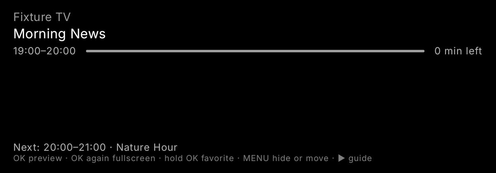
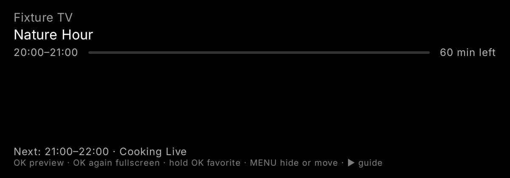

# UX08: programme boundary regression

Android TV API36 emulator, actual PreviewInfoPane rendered by an Android instrumentation test with fixed loaded guide rows. The clock advances from one minute before the boundary to the exact end time. No network, account or provider is used.

Before: cached Morning News remains current with 0 min left, while Nature Hour remains Next. The expected new-current-title assertion fails.

After: Nature Hour is current with 60 min left; Cooking Live is Next. The same UI regression passes.

TV focused unit/history/time-travel/architecture suite: 69 passed. Cross-platform checks: Android 22, iOS Native 7, tvOS Native 7, Desktop 22. Plus 1 Android TV emulator UI test: 128 passing checks total, zero failures or skips. Required platform compile gates passed. This is a component boundary check, not full live-provider playback validation.

UX observation: the footer packs five remote actions into one subdued line. Consider showing the focused action first and putting the remaining actions in contextual help. No hint/style redesign included here.
